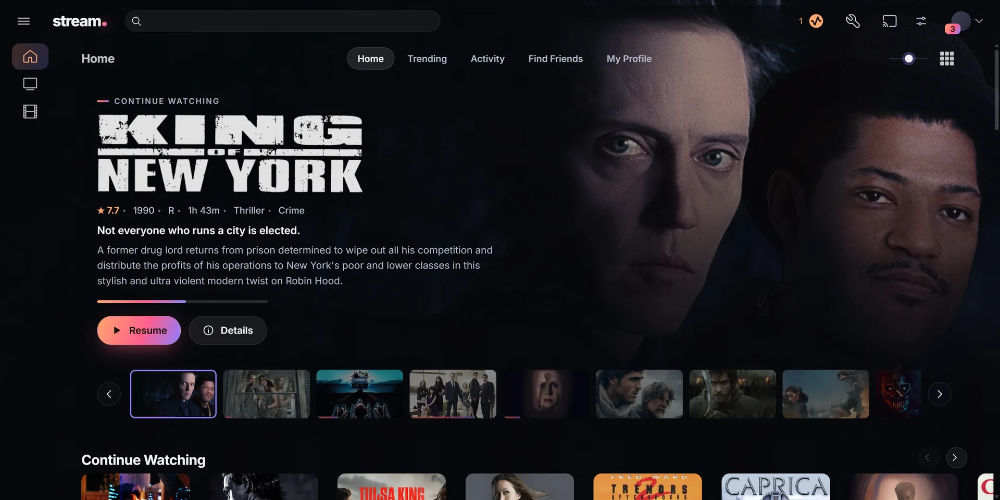
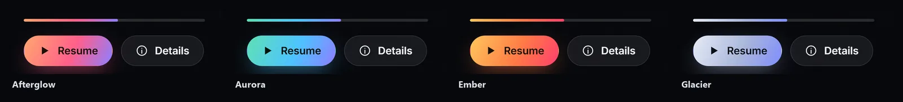
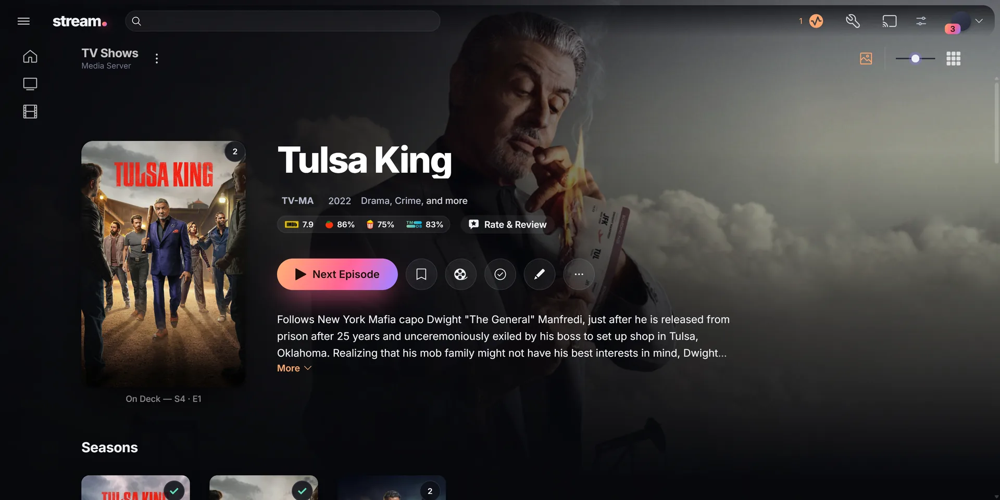
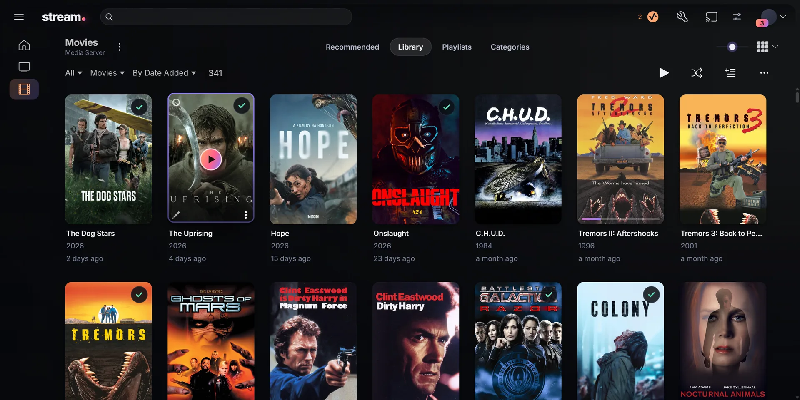
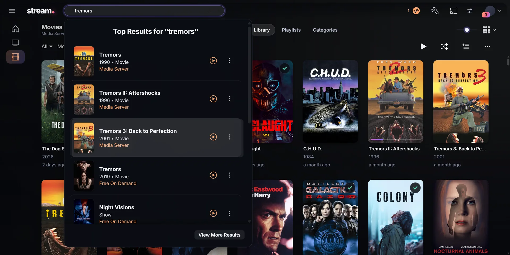
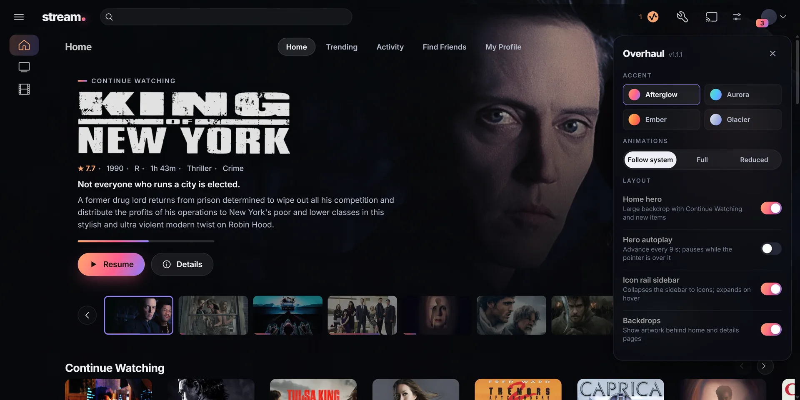
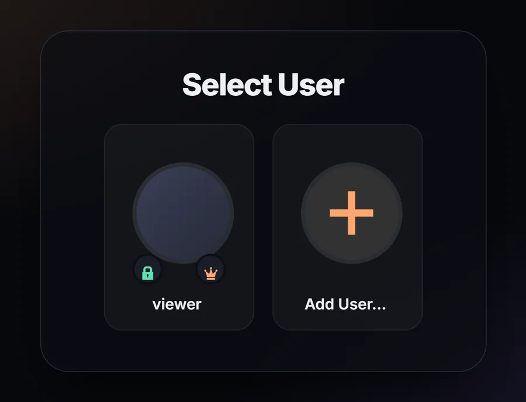

<div align="center">

# PlexOverhaul

**A new look and layout for Plex Web, as a userscript.**

Home hero &middot; Icon sidebar &middot; Full item backdrops &middot; Four accent presets &middot; Calm motion

[](https://github.com/kpg-anon/PlexOverhaul/raw/main/plex-overhaul.user.js)

[](CHANGELOG.md)
[]()
[](LICENSE)

</div>



---

## Install

1. Install a userscript manager such as [Violentmonkey](https://violentmonkey.github.io/).
2. Click **Install Userscript** above.
3. Open Plex Web on your server (`http://<server>:32400/web`, a `plex.direct` address, or your own domain).

It runs on any page whose path is `/web/index.html` and checks for Plex's markup first, so it does nothing on other sites. `app.plex.tv/desktop` is also matched.

## What it changes

- **Home** gets a hero built from Continue Watching and recently added items, with the item's background art behind the page.
- **Details pages** show the item's full background art instead of Plex's blurred copy.
- **Sidebar** becomes a 76px icon rail that expands on hover. Plex's menu button hides it.
- **Posters and rows** get rounded corners, a hover lift and gradient progress bars.
- **Player** gets a floating mini player bar and restyled controls.
- **Menus, dialogs, search, Plex's settings pages and the profile/PIN screen** use the same palette, with Inter as the typeface throughout.

## Settings

Click the sliders button next to your avatar. Settings are saved in the browser, per Plex address.

| Setting | Options |
| --- | --- |
| Accent | Afterglow, Aurora, Ember, Glacier |
| Animations | Follow system, Full, Reduced |
| Home hero | On / off |
| Hero autoplay | Off by default. Advances every 9 s and pauses on hover. |
| Icon rail sidebar | On / off |
| Backdrops | On / off |



## Screenshots

<table>
  <tr>
    <td></td>
    <td></td>
  </tr>
  <tr>
    <td></td>
    <td></td>
  </tr>
</table>

<p align="center"></p>

## Compatibility

Built against Plex Web 4.160 on Plex Media Server 1.43 and tested in Chrome. The `app.plex.tv` path has not been tested.

Plex renames its CSS classes with every web release. The script finds them by prefix at runtime, so most updates leave it working; a change to Plex's page structure can still break parts of it.

## Building

```console
npm run build
```

No dependencies. Writes `plex-overhaul.user.js`. Source layout and conventions are in [docs/DEVELOPMENT.md](docs/DEVELOPMENT.md).

## License

[MIT](LICENSE). Not affiliated with Plex, Inc.
